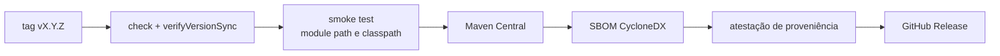

<div align="center">

# ☕ CoffeeMail Java SDK

**SDK oficial da CoffeeMail para Java 17+: envio transacional, domínios, templates, audiências, campanhas, supressões, webhooks e estatísticas, com cliente síncrono e assíncrono.**

[](https://central.sonatype.com/artifact/br.com.coffeemail/coffeemail-java)
[](https://github.com/Coffee-Mail/coffee-mail-sdk-java/actions/workflows/ci.yml)
[](#-requisitos)
[](LICENSE)

[Instalação](#-instalação) · [Início rápido](#-início-rápido) · [Erros](#️-tratamento-de-erros) · [Referência](#-referência) · [Webhooks](#-webhooks) · [Versionamento](#-versionamento-e-releases)

</div>

---

## 📑 Sumário

- [Visão geral](#-visão-geral)
- [Status do projeto](#-status-do-projeto)
- [Requisitos](#-requisitos)
- [Instalação](#-instalação)
- [Início rápido](#-início-rápido)
- [Configuração](#️-configuração)
- [Tratamento de erros](#️-tratamento-de-erros)
- [Referência](#-referência)
- [Webhooks](#-webhooks)
- [Versionamento e releases](#-versionamento-e-releases)
- [Testes e qualidade](#-testes-e-qualidade)
- [Scripts](#-scripts)
- [Estrutura do repositório](#️-estrutura-do-repositório)
- [Contribuição](#-contribuição)
- [Projetos relacionados](#-projetos-relacionados)
- [Licença](#-licença)

## ✨ Visão geral

- **Mesmo contrato dos SDKs oficiais** (Node.js, Python, PHP, Go): mesmos recursos, mesmos métodos e retorno em envelope em vez de exceção.
- **Síncrono e assíncrono**: `CoffeeMail` e `CoffeeMailAsync` (`CompletableFuture`) expõem as mesmas operações. A paridade é verificada por teste (`ApiParityTest`).
- **Nenhuma chamada de API lança exceção**: o resultado vem em `CoffeeMailResponse<T>` (sucesso ou falha, nunca os dois). `unwrap()` existe para quem prefere exceções.
- **Tipado**: modelos são `record`s imutáveis; enums de resposta têm o valor `UNKNOWN` para tolerar valores novos da API; builders recebem os campos obrigatórios no construtor (`SendEmailInput.builder(from, to)`).
- **Nulidade explícita**: todos os pacotes são `@NullMarked` ([JSpecify](https://jspecify.dev)) e o build verifica com NullAway. Campos opcionais são `Optional<T>`.
- **Validado contra o contrato da API**: as 71 operações cobertas geram requisições validadas contra o OpenAPI de produto (`spec/product.json`) em `ContractConformanceTest`.
- **Dependências mínimas**: `java.net.http.HttpClient` do JDK e Jackson 2.x; o transporte HTTP é plugável (`HttpTransport`).
- **JPMS**: módulo `br.com.coffeemail`, testado em module path e em classpath.

## 🚦 Status do projeto

| Item | Estado |
| --- | --- |
| Versão publicada | `0.1.0` no Maven Central (2026-10-14) |
| Cobertura da API de produto | 71 operações (todas as do `product.json`, exceto `GET /v1/product/auth/csrf`, exclusiva do dashboard) |
| Compatibilidade de API pública | Verificada no `check` contra a `0.1.0` (ver [Versionamento](#-versionamento-e-releases)) |
| Idiomas das mensagens de erro | `pt-BR` (padrão) e `en` |

Limitações conhecidas:

- **Pré-1.0**: a série `0.x` segue semver, mas a política da casa já proíbe quebrar a superfície pública (veja abaixo).
- **Sem retry automático**: `429` e `5xx` voltam como `RateLimitException`/`InternalServerException`. O `Retry-After` é exposto em `RateLimitException.retryAfterSeconds()`; a política de nova tentativa fica com quem chama.
- **`emails().sendBatch(...)` usa um único conjunto de cabeçalhos** para o lote: se vários itens definirem `idempotencyKey`, vale a do último; `sandbox(true)` em qualquer item ativa o sandbox para o lote inteiro.
- **`templates().previewById(...)`** não é um endpoint próprio: faz `GET /templates/{id}` e depois `POST /templates/preview` com o HTML do template (duas requisições).
- **Lacunas do `product.json`**: 18 respostas não têm schema ou declaram status diferente do que a API devolve (ex.: exclusões que respondem `204`), e `domains.delete` exige no spec uma credencial de reautenticação que a API dispensa para chaves de API. O teste de contrato lista essas lacunas explicitamente e falha quando o spec for corrigido, para que a lista seja removida.
- **Origem do spec**: `spec/product.json` é um snapshot do spec OpenAPI público da API de produto (`https://api.coffeemail.com.br/v1/product/docs/json`), atualizado com `./gradlew syncOpenApi`.

## 📋 Requisitos

| Uso | Requisito |
| --- | --- |
| Consumir o SDK | Java 17 ou superior (bytecode compilado com `--release 17`) |
| Dependências transitivas | `jackson-databind`, `jackson-datatype-jdk8`, `jackson-datatype-jsr310` 2.22.x (runtime); `org.jspecify:jspecify` 1.0.1 (só anotações) |
| Desenvolver o SDK | JDK 17+ para rodar o Gradle; o Gradle 9.8.1 (wrapper) provisiona o JDK 21 usado na compilação via toolchain |

O CI testa em JDK 17, 21 e 25.

## 📦 Instalação

Coordenadas: `br.com.coffeemail:coffeemail-java:0.1.0`.

Gradle (Kotlin DSL):

```kotlin
dependencies {
    implementation("br.com.coffeemail:coffeemail-java:0.1.0")
}
```

Gradle (Groovy):

```groovy
dependencies {
    implementation 'br.com.coffeemail:coffeemail-java:0.1.0'
}
```

Maven:

```xml
<dependency>
    <groupId>br.com.coffeemail</groupId>
    <artifactId>coffeemail-java</artifactId>
    <version>0.1.0</version>
</dependency>
```

Com JPMS, declare no seu `module-info.java`:

```java
requires br.com.coffeemail;
```

## 🚀 Início rápido

```java
import br.com.coffeemail.CoffeeMail;
import br.com.coffeemail.CoffeeMailResponse;
import br.com.coffeemail.models.emails.SendEmailInput;
import br.com.coffeemail.models.emails.SendEmailResponse;

CoffeeMail coffeemail = CoffeeMail.builder()
        .apiKey("cm_live_sua_chave")
        .build();

CoffeeMailResponse<SendEmailResponse> response = coffeemail.emails().send(
        SendEmailInput.builder("Loja <contato@seudominio.com.br>", "cliente@gmail.com")
                .subject("Pedido #123 confirmado")
                .html("<h1>Obrigado pela compra!</h1>")
                .idempotencyKey("pedido-123")
                .build());

response.data().ifPresent(sent -> System.out.println(sent.id() + " " + sent.status().value()));
```

Sem `apiKey(...)`, a chave vem da variável de ambiente `COFFEEMAIL_API_KEY`; `CoffeeMail.create()` faz exatamente isso com as configurações padrão. O cliente é thread-safe: crie uma instância e reutilize-a (por exemplo, como bean singleton no Spring, veja [`examples/`](examples/src/main/java/br/com/coffeemail/examples/spring/CoffeeMailConfiguration.java)).

### Cliente assíncrono

```java
import br.com.coffeemail.CoffeeMailAsync;

CoffeeMailAsync coffeemail = CoffeeMailAsync.create();

coffeemail.emails()
        .send(SendEmailInput.builder("contato@loja.com.br", "ana@gmail.com")
                .templateId("7c8d3f2b-8c1e-4a7d-be5f-3e4f5a601c2d")
                .build())
        .thenAccept(response -> response.data().ifPresent(sent -> System.out.println(sent.id())));
```

Os futuros nunca completam com exceção por erro de API ou de rede: o erro vem no envelope, como no cliente síncrono.

## ⚙️ Configuração

`CoffeeMail.builder()` e `CoffeeMailAsync.builder()` retornam o mesmo `CoffeeMailBuilder`:

| Método | Tipo | Padrão | Variável de ambiente |
| --- | --- | --- | --- |
| `apiKey(...)` | `String` | lida do ambiente | `COFFEEMAIL_API_KEY` |
| `locale(...)` | `CoffeeMailLocale` (`PT_BR`, `EN`) | `PT_BR` | — |
| `timeout(...)` | `Duration` | 10 segundos por requisição | — |
| `transport(...)` | `HttpTransport` | `java.net.http.HttpClient` (segue redirecionamentos) | — |

- O host da API é fixo em `https://api.coffeemail.com.br` e não é configurável. É uma decisão de segurança: a chave de API só trafega para o host oficial.
- `build()` lança `AuthenticationException` se não houver chave (nem explícita nem no ambiente) ou se ela estiver em branco.
- `locale` define o idioma das mensagens geradas pelo SDK e o cabeçalho `Accept-Language` enviado à API.
- Toda requisição envia `Authorization: Bearer <chave>` e `User-Agent: coffeemail-java/<versão>`. `CoffeeMail.version()` retorna a versão.
- `HttpTransport` é uma interface funcional (`CompletableFuture<HttpResponse> send(HttpRequest request, Duration timeout)`), útil para proxy, instrumentação ou testes sem rede.

Cabeçalhos por envio, definidos no `SendEmailInput`:

| Builder | Cabeçalho HTTP |
| --- | --- |
| `idempotencyKey(String)` | `x-idempotency-key` |
| `sandbox(true)` | `x-coffeemail-sandbox: true` |

## 🛡️ Tratamento de erros

Toda operação retorna `CoffeeMailResponse<T>`, uma `sealed interface` com `Success` e `Failure`:

| Método | Retorno |
| --- | --- |
| `isSuccess()` | `boolean` |
| `data()` | `Optional<T>` |
| `error()` | `Optional<CoffeeMailException>` |
| `unwrap()` | `T`, ou lança o `CoffeeMailException` |
| `fold(onSuccess, onFailure)` | reduz a um único valor |
| `map(mapper)` | transforma o dado, preservando a falha |

```java
CoffeeMailResponse<SendEmailResponse> response = coffeemail.emails().send(input);

response.error().ifPresent(error -> {
    System.err.println(error.code() + " " + error.getMessage());
    error.requestId().ifPresent(id -> System.err.println("x-request-id: " + id));
});

String id = coffeemail.emails().send(input).unwrap().id();

String outcome = response.fold(
        sent -> "Enfileirado: " + sent.id(),
        error -> "Falhou: " + error.getMessage());
```

Operações sem corpo de resposta (exclusões, cancelamentos) retornam `CoffeeMailResponse<NoContent>`.

Todas as falhas estendem `CoffeeMailException` (unchecked, pacote `br.com.coffeemail.errors`) e expõem:

| Método | Conteúdo |
| --- | --- |
| `status()` | status HTTP (`0` quando não há resposta HTTP correspondente) |
| `code()` | código canônico, igual entre os SDKs (constantes em `ErrorCodes`) |
| `apiCode()` | `Optional` com o código original da API, como `TEMPLATE_NOT_FOUND` |
| `details()` | `Map` com `error.meta` e `error.details` da resposta |
| `requestId()` | `Optional` com o `x-request-id` da resposta |

| Classe | `code()` | Status HTTP | Quando ocorre | Equivalente no SDK Node.js |
| --- | --- | --- | --- | --- |
| `ValidationException` | `VALIDATION_ERROR` | 400 | payload ou parâmetros inválidos | `ValidationError` |
| `AuthenticationException` | `UNAUTHORIZED` | 401 | chave ausente, inválida ou revogada | `AuthenticationError` |
| `PaymentRequiredException` | `PAYMENT_REQUIRED` | 402 | plano ou cota exige pagamento | `PaymentRequiredError` |
| `ForbiddenException` | `FORBIDDEN` | 403 | chave sem permissão para o recurso | `ForbiddenError` |
| `NotFoundException` | `NOT_FOUND` | 404 | recurso inexistente | `NotFoundError` |
| `ConflictException` | `CONFLICT` | 409 | conflito de estado ou duplicidade | `ConflictError` |
| `RateLimitException` | `RATE_LIMIT_EXCEEDED` | 429 | limite de requisições; `retryAfterSeconds()` lê o `Retry-After` | `RateLimitError` |
| `InternalServerException` | `INTERNAL_SERVER_ERROR` | 500, 502, 503, 504 | falha do servidor | `InternalServerError` |
| `NetworkException` | `NETWORK_ERROR` | `0` | sem resposta: falha de rede ou timeout | `NetworkError` |
| `PermissionException` | `PERMISSION_DENIED` | `0` | 403 em `broadcasts()`: a operação exige `full_access`; `requiredPermission()` retorna `full_access` | `PermissionError` |
| `CoffeeMailException` | `apiCode()` da API ou `API_ERROR` | qualquer outro status não-2xx (ex.: 422) | status sem classe dedicada | `CoffeeMailError` |
| `CoffeeMailException` | `INVALID_RESPONSE` | status da resposta | resposta 2xx com JSON que não decodifica no modelo esperado | — |

```java
import br.com.coffeemail.errors.RateLimitException;

response.error()
        .filter(RateLimitException.class::isInstance)
        .map(RateLimitException.class::cast)
        .ifPresent(limit -> System.err.println("Tente de novo em " + limit.retryAfterSeconds().orElse(1) + "s"));
```

O SDK não refaz requisições automaticamente.

## 📚 Referência

Os recursos são interfaces em `br.com.coffeemail.resources` (fáceis de simular em testes). Cada um tem a versão `*Async` com as mesmas assinaturas, retornando `CompletableFuture<CoffeeMailResponse<T>>`. Todas as rotas ficam sob `/v1/product`.

### Introspecção da chave de API

| Método | Retorno | HTTP |
| --- | --- | --- |
| `introspect()` | `ApiKeyIntrospection` (`id`, `name`, `organisationId`, `scopes`) | `GET /auth/me/api-key` |
| `introspect(boolean forceRefresh)` | idem, ignorando o cache quando `true` | `GET /auth/me/api-key` |
| `invalidateApiKeyCache()` | `void` | — |

O resultado fica em cache por 5 minutos.

```java
coffeemail.introspect().data().ifPresent(key -> System.out.println(key.scopes()));
```

### E-mails — `coffeemail.emails()`

| Método | Retorno | HTTP |
| --- | --- | --- |
| `send(SendEmailInput)` | `SendEmailResponse` | `POST /emails` |
| `sendBatch(List<SendEmailInput>)` | `List<BatchSendEmailResult>` | `POST /emails/batch` |
| `get(String id)` | `EmailDetail` | `GET /emails/{id}` |
| `list()` / `list(ListEmailsQuery)` | `ListEmailsResponse` | `GET /emails` |
| `getEvents(String id)` | `EmailEventsResponse` | `GET /emails/{id}/events` |
| `getTags()` | `ListEmailTagsResponse` | `GET /emails/tags` |
| `cancel(String id)` | `NoContent` | `POST /emails/{id}/cancel` |
| `resend(String id)` | `SendEmailResponse` | `POST /emails/{id}/resend` |

`SendEmailInput.builder(from, to)` aceita `cc`, `bcc`, `replyTo`, `subject`, `html`, `text`, `templateId` (id ou alias do template, como `boas-vindas`), `variables`, `scheduledAt`, `headers`, `attachments`, `tags`, `idempotencyKey`, `emailType`, `suppressionCategory`, `metadata` e `sandbox`. `ListEmailsQuery` filtra por `status`, `recipient`, `fromEmail`, `subjectContains`, `apiKeyId`, `tag`, `from`/`to` (período) e pagina com `after`/`limit`.

```java
EmailAttachment nota = EmailAttachment.fromBytes("nota.pdf", bytes).withContentType("application/pdf");

coffeemail.emails().send(SendEmailInput.builder("contato@loja.com.br", "cliente@gmail.com")
        .cc("financeiro@cliente.com.br")
        .templateId("boas-vindas")
        .variables(Map.of("nome", "Ana"))
        .attachments(nota)
        .tags(new EmailTag("pedido", "123"))
        .scheduledAt(Instant.parse("2026-12-01T09:00:00Z"))
        .sandbox(true)
        .build());

coffeemail.emails().list(ListEmailsQuery.builder().status(EmailStatus.BOUNCED).limit(50).build());
```

### Domínios — `coffeemail.domains()`

| Método | Retorno | HTTP |
| --- | --- | --- |
| `create(String name)` | `CreateDomainResponse` | `POST /domains` |
| `list()` | `ListDomainsResponse` | `GET /domains` |
| `get(String id)` | `DomainDetail` | `GET /domains/{id}` |
| `verify(String id)` | `VerifyDomainResponse` | `POST /domains/{id}/verify` |
| `delete(String id)` | `DeleteDomainResponse` | `DELETE /domains/{id}` |
| `getHealth(String id)` | `DomainHealthResponse` | `POST /domains/{id}/health` |
| `getWarmupStatus(String id)` | `Optional<DomainWarmupStatus>` | `GET /domains/{id}/warmup` |
| `rotateDkim(String id)` | `DkimRotation` | `POST /domains/{id}/dkim/rotate` |
| `setTrackingDomain(String id, String host)` | `CustomHostStatus` | `PUT /domains/{id}/tracking-domain` |
| `removeTrackingDomain(String id)` | `Optional<CustomHostStatus>` | `DELETE /domains/{id}/tracking-domain` |

`DomainDetail` traz `dkimRotation()` (rotação pendente), `returnPath()` (return-path próprio, `bounces.<domínio>`), `trackingDomain()` (host de tracking próprio) e `trackingDomainsAvailable()` (se a plataforma permite cadastrar host de tracking). `CustomHostStatus` informa `host`, `target` (alvo do CNAME), `verified`, `verifiedAt` e o `record` a publicar. `DomainWarmupStatus` traz a fase (`status()`: `WARMING` ou `COMPLETED`), `totalDays()`, `startedAt()` e `completedAt()`.

`rotateDkim` é idempotente: com uma rotação pendente, devolve a mesma. A chave em uso só muda quando o TXT do novo seletor aparece no DNS. Falha com `NotFoundException` (`apiCode()` `DOMAIN_NOT_FOUND`) ou `ConflictException` (`DOMAIN_NOT_VERIFIED`). `setTrackingDomain` falha com `ValidationException` (`INVALID_TRACKING_HOST`, host fora do domínio de envio), `ConflictException` (`TRACKING_DOMAINS_DISABLED`) ou `NotFoundException`.

```java
coffeemail.domains().create("loja.com.br").data().ifPresent(domain ->
        domain.dkimRecordsToPublish().forEach(record ->
                System.out.println(record.type() + " " + record.host() + " " + record.value())));

coffeemail.domains().rotateDkim(domainId).data().ifPresent(rotation ->
        System.out.println("Publique " + rotation.record().host() + " TXT " + rotation.record().value()));

coffeemail.domains().setTrackingDomain(domainId, "links.loja.com.br").data().ifPresent(tracking ->
        System.out.println(tracking.record().host() + " CNAME " + tracking.target()));
```

### Templates — `coffeemail.templates()`

| Método | Retorno | HTTP |
| --- | --- | --- |
| `create(CreateTemplateInput)` | `TemplateDetail` | `POST /templates` |
| `list()` / `list(ListTemplatesQuery)` | `ListTemplatesResponse` | `GET /templates` |
| `get(String id)` | `TemplateDetail` | `GET /templates/{id}` |
| `update(String id, UpdateTemplateInput)` | `TemplateDetail` | `PATCH /templates/{id}` |
| `delete(String id)` | `NoContent` | `DELETE /templates/{id}` |
| `preview(PreviewTemplateInput)` | `PreviewTemplateResponse` | `POST /templates/preview` |
| `previewById(String templateId)` / `previewById(String, Map<String, Object> variables)` | `PreviewTemplateResponse` | `GET /templates/{id}` + `POST /templates/preview` |
| `format(FormatTemplateInput)` | `FormatTemplateResponse` | `POST /templates/format` |
| `testRender(TestRenderTemplateInput)` | `TestRenderTemplateResponse` | `POST /templates/test-render` |
| `testSend(String id, TestSendTemplateInput)` | `TestSendTemplateResponse` | `POST /templates/{id}/test-send` |
| `listVersions(String id)` / `listVersions(String, OffsetPaginationQuery)` | `ListTemplateVersionsResponse` (`data`, `total`) | `GET /templates/{id}/versions` |
| `getVersion(String id, int version)` | `TemplateVersionDetail` | `GET /templates/{id}/versions/{version}` |
| `restoreVersion(String id, int version)` | `TemplateDetail` | `POST /templates/{id}/versions/{version}/restore` |

Em `UpdateTemplateInput`, só os campos definidos no builder são enviados; os métodos `clear*` (`clearAlias`, `clearSubject`, `clearPreheader`, `clearContentJson`, `clearTextPayload`) enviam `null` explícito.

```java
coffeemail.templates().update(templateId, UpdateTemplateInput.builder()
        .subject("Novo assunto")
        .clearPreheader()
        .build());
```

Cada alteração grava uma versão. `listVersions` devolve resumos (`TemplateVersionSummary`: `version`, `name`, `subject`, `createdBy`, `createdAt`), da mais recente para a mais antiga, com `limit` de 1 a 100 e `offset`; `getVersion` traz o conteúdo completo (`html`, `preheader`, `contentJson`, `textPayload`, `variables`, `format`, `sourceLocale`). `restoreVersion` torna aquela versão o conteúdo atual e grava o estado anterior como versão nova. Falham com `NotFoundException` e `apiCode()` `TEMPLATE_NOT_FOUND` ou `TEMPLATE_VERSION_NOT_FOUND`.

```java
coffeemail.templates()
        .listVersions(templateId, OffsetPaginationQuery.builder().limit(10).build())
        .data()
        .ifPresent(page -> page.data().forEach(version -> System.out.println(version.version() + " " + version.createdAt())));

coffeemail.templates().restoreVersion(templateId, 3);
```

### Audiências e contatos — `coffeemail.audiences()`

| Método | Retorno | HTTP |
| --- | --- | --- |
| `create(CreateAudienceInput)` | `AudienceDetail` | `POST /audiences` |
| `list()` / `list(OffsetPaginationQuery)` | `ListAudiencesResponse` | `GET /audiences` |
| `get(String id)` | `AudienceDetail` | `GET /audiences/{id}` |
| `update(String id, UpdateAudienceInput)` | `UpdateAudienceResult` | `PUT /audiences/{id}` |
| `delete(String id)` | `NoContent` | `DELETE /audiences/{id}` |
| `contacts()` | `Contacts` (tabela abaixo) | — |
| `listContacts(String audienceId)` / `listContacts(String, OffsetPaginationQuery)` | `ListContactsResponse` | atalho de `contacts().list` |
| `createContact(String audienceId, CreateContactInput)` | `ContactDetail` | atalho de `contacts().create` |
| `bulkAddContacts(String audienceId, List<CreateContactInput>)` | `BulkAddContactsResult` | atalho de `contacts().bulkAdd` |

`coffeemail.audiences().contacts()`:

| Método | Retorno | HTTP |
| --- | --- | --- |
| `create(String audienceId, CreateContactInput)` | `ContactDetail` | `POST /audiences/{id}/contacts` |
| `list(String audienceId)` / `list(String, OffsetPaginationQuery)` | `ListContactsResponse` | `GET /audiences/{id}/contacts` |
| `bulkAdd(String audienceId, List<CreateContactInput>)` | `BulkAddContactsResult` | `POST /audiences/{id}/contacts/bulk` |
| `update(String audienceId, String contactId, UpdateContactInput)` | `UpdateContactResult` | `PUT /audiences/{id}/contacts/{contactId}` |
| `delete(String audienceId, String contactId)` | `NoContent` | `DELETE /audiences/{id}/contacts/{contactId}` |

```java
String audienceId = coffeemail.audiences()
        .create(CreateAudienceInput.builder("Clientes VIP").build())
        .unwrap()
        .id();

coffeemail.audiences().contacts().create(audienceId,
        CreateContactInput.builder("ana@gmail.com").firstName("Ana").build());
```

`AudienceDetail.contactsCount()` e `ListTemplatesResponse.data()` estão depreciados em favor de `totalContacts()` e `templates()`; continuam retornando o mesmo valor.

### Campanhas — `coffeemail.broadcasts()`

| Método | Retorno | HTTP |
| --- | --- | --- |
| `create(CreateBroadcastInput)` | `BroadcastDetail` | `POST /broadcasts` |
| `list()` / `list(ListBroadcastsQuery)` | `ListBroadcastsResponse` | `GET /broadcasts` |
| `get(String id)` | `BroadcastDetail` | `GET /broadcasts/{id}` |
| `send(String id)` | `SendBroadcastResult` | `POST /broadcasts/{id}/send` |
| `cancel(String id)` | `CancelBroadcastResult` | `POST /broadcasts/{id}/cancel` |
| `testSend(String id, TestSendBroadcastInput)` | `TestSendBroadcastResult` | `POST /broadcasts/{id}/test-send` |

Exige uma chave com permissão `full_access`; com outra chave, o 403 vira `PermissionException`. `CreateBroadcastInput` aceita exatamente um entre template (`fromTemplate(audienceId, fromEmail, templateId)`) e HTML (`fromHtml(audienceId, fromEmail, subject, html)`).

```java
coffeemail.broadcasts().create(
        CreateBroadcastInput.fromTemplate(audienceId, "news@loja.com.br", templateId).build());
```

### Remetentes — `coffeemail.senders()`

| Método | Retorno | HTTP |
| --- | --- | --- |
| `create(CreateSenderInput)` | `SenderDetail` | `POST /senders` |
| `list()` | `ListSendersResponse` | `GET /senders` |
| `verify(String token)` | `VerifySenderResult` | `POST /senders/verify` |
| `delete(String id)` | `NoContent` | `DELETE /senders/{id}` |

```java
coffeemail.senders().create(CreateSenderInput.builder("contato@loja.com.br").displayName("Loja").build());
```

### Supressões — `coffeemail.suppressions()`

| Método | Retorno | HTTP |
| --- | --- | --- |
| `list()` / `list(ListSuppressionsQuery)` | `ListSuppressionsResponse` | `GET /suppressions` |
| `get(String id)` | `SuppressionDetail` | `GET /suppressions/{id}` |
| `create(CreateSuppressionInput)` | `SuppressionDetail` | `POST /suppressions` |
| `delete(String id)` | `NoContent` | `DELETE /suppressions/{id}` |
| `reactivate(String id)` | `NoContent` | `POST /suppressions/{id}/reactivate` |
| `bulkCreate(List<BulkSuppressionEntry>)` | `BulkCreateSuppressionsResult` | `POST /suppressions/bulk` |

```java
coffeemail.suppressions().create(CreateSuppressionInput.builder("ex-cliente@gmail.com")
        .reason(CreateSuppressionReason.MANUAL)
        .build());
```

### Webhooks — `coffeemail.webhooks()`

| Método | Retorno | HTTP |
| --- | --- | --- |
| `create(CreateWebhookInput)` | `CreatedWebhookDetail` (inclui o `secret`) | `POST /webhooks` |
| `list()` / `list(ListWebhooksQuery)` | `ListWebhooksResponse` | `GET /webhooks` |
| `get(String id)` | `WebhookDetail` | `GET /webhooks/{id}` |
| `update(String id, UpdateWebhookInput)` | `WebhookDetail` | `PUT /webhooks/{id}` |
| `toggle(String id, ToggleableWebhookStatus)` | `ToggleWebhookResult` | `PATCH /webhooks/{id}` |
| `delete(String id)` | `NoContent` | `DELETE /webhooks/{id}` |
| `rotateSecret(String id)` | `RotateWebhookSecretResult` | `POST /webhooks/{id}/rotate-secret` |
| `listDeliveries(String id)` / `listDeliveries(String, ListWebhookDeliveriesQuery)` | `ListWebhookDeliveriesResponse` | `GET /webhooks/{id}/deliveries` |
| `getDelivery(String id, String deliveryId)` | `WebhookDeliveryDetail` (inclui `requestPayload`) | `GET /webhooks/{id}/deliveries/{deliveryId}` |
| `replayDelivery(String id, String deliveryId)` | `WebhookDeliveryDetail` (entrega nova, `PENDING`) | `POST /webhooks/{id}/deliveries/{deliveryId}/replay` |
| `test(String id)` | `TestWebhookResult` | `POST /webhooks/{id}/test` |
| `verifySignature(VerifyWebhookInput)` | `boolean` | — (local, ver [Webhooks](#-webhooks)) |

```java
String secret = coffeemail.webhooks()
        .create(CreateWebhookInput.builder(
                        "https://loja.com.br/webhooks/coffeemail",
                        List.of(WebhookEventType.EMAIL_DELIVERED, WebhookEventType.EMAIL_BOUNCED))
                .build())
        .unwrap()
        .secret();

coffeemail.webhooks().toggle(webhookId, ToggleableWebhookStatus.PAUSED);

coffeemail.webhooks().replayDelivery(webhookId, deliveryId);
```

`getDelivery` traz o corpo JSON enviado ao endpoint em `requestPayload()`; `delivery()` devolve a mesma entrega no formato da listagem. `replayDelivery` reenvia o mesmo corpo como uma entrega nova (HTTP 202). Erros em `apiCode()`: `WEBHOOK_NOT_FOUND` e `WEBHOOK_DELIVERY_NOT_FOUND` (`NotFoundException`), `WEBHOOK_DELIVERY_PENDING` (entrega ainda em andamento) e `WEBHOOK_NOT_ACTIVE` (webhook pausado), ambos `ConflictException`.

Eventos disponíveis em `WebhookEventType`: `email.queued`, `email.processing`, `email.sent`, `email.delivered`, `email.delivery_delayed`, `email.opened`, `email.clicked`, `email.bounced`, `email.complained`, `email.failed`, `email.suppressed`, `email.scheduled`, `email.cancelled`, `email.unsubscribed`, `billing.plan_changed`.

### Estatísticas — `coffeemail.stats()`

| Método | Retorno | HTTP |
| --- | --- | --- |
| `get()` / `get(GetStatsQuery)` | `StatsResponse` | `GET /stats` |

`GetStatsQuery` aceita `domainId`, `tag`, `startDate`, `endDate`, `granularity` (`DAY`, `WEEK`, `MONTH`), `period` (`LAST7D`, `LAST30D`, `LAST90D`) e `emailType`.

```java
coffeemail.stats().get(GetStatsQuery.builder()
        .period(StatsPeriod.LAST30D)
        .granularity(StatsGranularity.WEEK)
        .build());
```

### Validação de e-mails — `coffeemail.validation()`

| Método | Retorno | HTTP |
| --- | --- | --- |
| `validate(List<String> emails)` | `ValidateEmailsResponse` (`items`, `validCount`, `invalidCount`, `credits`) | `POST /validate` |

Valida de 1 a 100 endereços por chamada: sintaxe (`formatValid`), servidor de e-mail do domínio (`mxValid`) e domínio descartável (`isDisposable`); `reason()` traz `invalid_format`, `disposable_email` ou `no_mx_record` quando o endereço é reprovado. Cada endereço consome um crédito do mês, e `credits()` (`limit`, `used`, `remaining`, vazios quando o plano é ilimitado; `isUnlimited()`) mostra o saldo após a chamada. Com os créditos esgotados, a falha é `RateLimitException` com `apiCode()` `VALIDATION_CREDITS_EXHAUSTED`: não adianta tentar de novo antes do mês seguinte.

```java
coffeemail.validation()
        .validate(List.of("cliente@gmail.com", "teste@mailinator.com"))
        .data()
        .ifPresent(result -> result.items().stream()
                .filter(item -> item.reason().isPresent())
                .forEach(item -> System.out.println(item.email() + ": " + item.reason().get())));
```

## 🔔 Webhooks

Cada entrega traz os cabeçalhos `x-webhook-signature`, `x-webhook-timestamp` e `x-webhook-idempotency-key` (e `x-webhook-test` nos disparos de teste). A assinatura é `sha256=` + HMAC-SHA256 hexadecimal de `timestamp.idempotencyKey.corpo`, com o `secret` do webhook. O `WebhookVerifier`:

- compara em tempo constante (`MessageDigest.isEqual`);
- rejeita timestamps fora da janela de tolerância (padrão: 5 minutos, para os dois lados), contra replay;
- nunca lança: retorna `false` para cabeçalho ausente, timestamp inválido ou assinatura divergente.

Valide sempre o **corpo bruto**, nunca o JSON reserializado. Exemplo com Spring (o mesmo de [`examples/`](examples/src/main/java/br/com/coffeemail/examples/spring/CoffeeMailWebhookController.java)):

```java
import br.com.coffeemail.webhooks.VerifyWebhookInput;
import br.com.coffeemail.webhooks.WebhookVerifier;

@PostMapping("/webhooks/coffeemail")
public ResponseEntity<Void> receive(@RequestBody String rawBody, @RequestHeader Map<String, String> headers) {
    boolean authentic = WebhookVerifier.verifySignature(
            VerifyWebhookInput.fromHeaders(rawBody, headers, System.getenv().getOrDefault("COFFEEMAIL_WEBHOOK_SECRET", "")));
    if (!authentic) {
        return ResponseEntity.status(HttpStatus.UNAUTHORIZED).build();
    }
    return ResponseEntity.noContent().build();
}
```

| API | Uso |
| --- | --- |
| `WebhookVerifier.verifySignature(VerifyWebhookInput)` | verificação estática com tolerância padrão |
| `WebhookVerifier.builder().tolerance(Duration).clock(Clock).build().verify(...)` | tolerância ou relógio customizados |
| `coffeemail.webhooks().verifySignature(...)` | o mesmo, a partir do cliente |
| `VerifyWebhookInput.fromHeaders(String ou byte[] payload, Map<String, String> headers, String secret)` | monta a entrada a partir dos cabeçalhos (nomes sem diferenciar maiúsculas) |
| `new VerifyWebhookInput(payload, signature, timestamp, idempotencyKey, secret)` | monta a entrada campo a campo |

O `WebhookVerifierTest` valida a verificação com vetores gerados pelo assinador da API (`src/test/resources/webhooks/vectors.json`). Use o `x-webhook-idempotency-key` para descartar entregas duplicadas.

## 🔖 Versionamento e releases

- **Semver** ([semver.org](https://semver.org/lang/pt-BR/)). A versão fica em `gradle.properties` (`version=`), é gerada em `SdkVersion` no build e enviada no `User-Agent`.
- **Compatibilidade retroativa**: o SDK é publicado e usado em produção. Mudanças na API pública só **adicionam ou depreciam**; nunca renomeiam nem removem.
- **Verificação automática de compatibilidade**: a task `verifyApiCompatibility` ([japicmp](https://github.com/melix/japicmp-gradle-plugin)) baixa do Maven Central a versão definida em `apiBaselineVersion` (hoje `0.1.0`, em `gradle.properties`) e compara com o JAR atual. Ela roda dentro de `./gradlew check` (local, CI e publicação) e falha em qualquer incompatibilidade binária ou de código-fonte. Ficam fora da comparação os pacotes `br.com.coffeemail.internal*` e `br.com.coffeemail.models.support`, e métodos novos em interfaces de recurso são permitidos (as implementações são do SDK). Relatório: `build/reports/japicmp/index.html`. Com `apiBaselineVersion` vazio, a task é pulada.
- **Changelog**: [CHANGELOG.md](CHANGELOG.md) no formato Keep a Changelog; mudanças entram em "Não lançado".

Publicação (workflow [`publish.yml`](.github/workflows/publish.yml), disparado por tag `v*`):

1. Atualize `version` em `gradle.properties` e mova as entradas do CHANGELOG para a nova versão.
2. Crie e envie a tag `vX.Y.Z`.
3. O workflow roda `./gradlew check verifyVersionSync -PreleaseTag=vX.Y.Z` (a tag precisa bater com a versão), o smoke test do artefato em module path e classpath, `publishAndReleaseToMavenCentral` (assinado), gera o SBOM CycloneDX, a atestação de proveniência do build e o GitHub Release com as notas extraídas do CHANGELOG.



## 🧪 Testes e qualidade

`./gradlew check` é o gate local e de CI. Ele roda:

| Gate | Detalhe |
| --- | --- |
| Compilação | `--release 17`, `-Xlint:all -Werror`, Error Prone + NullAway (modo JSpecify) como erro |
| Formatação | Spotless com Palantir Java Format |
| Estilo | Checkstyle com `maxWarnings = 0` (regras da casa: sem `else`/`switch`, sem comentários, `final`, sem números mágicos etc.) |
| Testes | JUnit + AssertJ; arquitetura com ArchUnit; paridade sync/async; contrato contra o OpenAPI |
| Cobertura | JaCoCo mínimo de 85% de linhas e 78% de branches |
| Javadoc | `-Xdoclint:all,-missing -Werror` |
| Compatibilidade | `verifyApiCompatibility` contra `apiBaselineVersion` |
| Versão | `verifyVersionSync` (formato semver) |
| Snapshot do spec | `verifyOpenApiSnapshot`: falha se `spec/product.json` divergir do spec em `COFFEEMAIL_OPENAPI_SPEC`; é pulada quando a variável não está definida (como no CI) |

CI ([`ci.yml`](.github/workflows/ci.yml)): `check` em JDK 17, 21 e 25 (`-PtestJavaVersion`), relatório de cobertura como artefato no JDK 21, e um job de smoke test que publica no Maven local e roda `smoke-test/` em module path e classpath.

IDEs baseadas no Eclipse JDT (VS Code/Antigravity com a extensão Java da Red Hat, ou Eclipse) devem usar `config/eclipse/org.eclipse.jdt.core.prefs`, que alinha a análise de nulidade ao NullAway; detalhes no [CONTRIBUTING.md](CONTRIBUTING.md).

## 🧰 Scripts

| Comando | O que faz |
| --- | --- |
| `./gradlew check` | todos os gates acima |
| `./gradlew test` | só os testes (JDK 17 por padrão) |
| `./gradlew test -PtestJavaVersion=21` | testes em outro JDK |
| `./gradlew spotlessApply` | formata o código |
| `./gradlew verifyApiCompatibility` | só a verificação de compatibilidade contra a `0.1.0` |
| `./gradlew jacocoTestReport` | relatório de cobertura em `build/reports/jacoco/test/html` |
| `./gradlew syncOpenApi` | copia o spec para `spec/product.json` a partir de `COFFEEMAIL_OPENAPI_SPEC` (arquivo ou URL) ou, sem ela, do spec público da API |
| `./gradlew verifyOpenApiSnapshot` | confere se o snapshot está igual ao spec de origem |
| `./gradlew publishToMavenLocal` | publica no `~/.m2` |
| `./gradlew -p smoke-test run -Pmodular=true` | smoke test do artefato publicado localmente (`-Pmodular=false` para classpath; `-PsdkVersion=` muda a versão, padrão `0.1.0`) |
| `./gradlew :examples:run` | roda `SendEmailExample` (requer `COFFEEMAIL_API_KEY`; envia em sandbox) |
| `./gradlew :cyclonedxDirectBom --no-configuration-cache` | gera o SBOM em `build/reports/cyclonedx-direct/bom.json` |

## 🗂️ Estrutura do repositório

```text
.
├── src/main/java/
│   ├── module-info.java                 # módulo br.com.coffeemail
│   └── br/com/coffeemail/
│       ├── CoffeeMail*.java             # clientes, builder, envelope, locale
│       ├── resources/                   # interfaces públicas dos recursos (sync e async)
│       ├── models/                      # records e enums por recurso
│       ├── errors/                      # hierarquia de CoffeeMailException
│       ├── transport/                   # HttpTransport plugável
│       ├── webhooks/                    # WebhookVerifier
│       └── internal/                    # implementação (não exportada pelo módulo)
├── src/test/                            # testes unitários, contrato, arquitetura, vetores de webhook
├── spec/product.json                    # snapshot do OpenAPI de produto da API
├── examples/                            # Java puro, assíncrono e Spring (subprojeto Gradle)
├── smoke-test/                          # build separado que consome o artefato publicado
├── config/checkstyle/, config/eclipse/  # regras de estilo e preferências do JDT
├── gradle/libs.versions.toml            # catálogo de versões
└── .github/workflows/                   # ci.yml e publish.yml
```

## 🤝 Contribuição

Leia o [CONTRIBUTING.md](CONTRIBUTING.md) antes de abrir um PR. Em resumo: código em inglês, prosa e commits em pt-BR (`tipo(escopo): descrição`), `./gradlew check` verde, testes com caminho feliz e ao menos dois caminhos de erro, CHANGELOG atualizado e API pública só com adições ou depreciações. Quando o OpenAPI da API mudar, rode `./gradlew syncOpenApi` e mantenha o `ContractConformanceTest` verde.

Vulnerabilidades: não abra issue pública; siga o [SECURITY.md](SECURITY.md). Código de conduta: [CODE_OF_CONDUCT.md](CODE_OF_CONDUCT.md).

## 🔗 Projetos relacionados

| Repositório | Papel |
| --- | --- |
| [coffee-mail-sdk-node](https://github.com/Coffee-Mail/coffee-mail-sdk-node) | SDK oficial Node.js/TypeScript (`@coffeemail/node`) |
| [coffee-mail-sdk-python](https://github.com/Coffee-Mail/coffee-mail-sdk-python) | SDK oficial Python (`coffeemail`) |
| [coffee-mail-sdk-php](https://github.com/Coffee-Mail/coffee-mail-sdk-php) | SDK oficial PHP (`coffeemail/coffeemail-php`) |
| **coffee-mail-sdk-java** (você está aqui) | SDK oficial Java (`br.com.coffeemail:coffeemail-java`) |
| [coffee-mail-sdk-go](https://github.com/Coffee-Mail/coffee-mail-sdk-go) | SDK oficial Go (`github.com/Coffee-Mail/coffee-mail-sdk-go`) |
| [coffee-mail-sdk-ruby](https://github.com/Coffee-Mail/coffee-mail-sdk-ruby) | SDK oficial Ruby (`coffeemail`) |
| [coffee-mail-laravel](https://github.com/Coffee-Mail/coffee-mail-laravel) | Integração Laravel (`coffeemail/coffeemail-laravel`) |
| [coffee-mail-sdk-workbench](https://github.com/Coffee-Mail/coffee-mail-sdk-workbench) | Bancada de validação dos SDKs por spec (inclui `runner-java`) |

## 📄 Licença

[MIT](LICENSE) © 2026 Dev-Etto.
